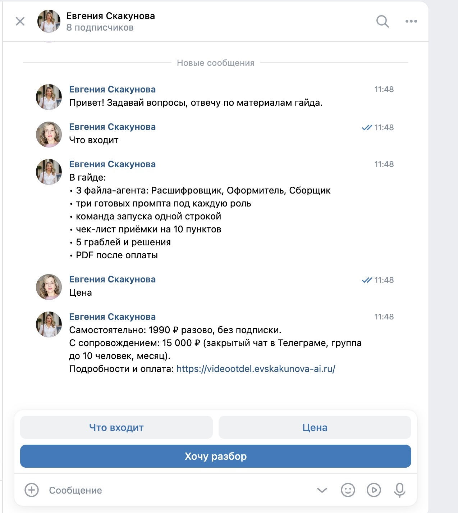
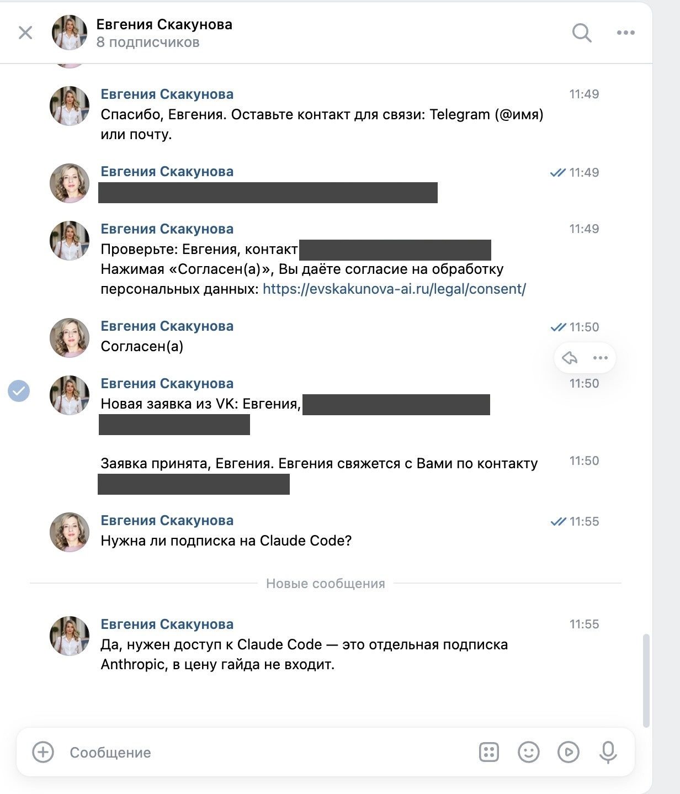

# VK AI-бот: помощник по гайду «Видео-отдел в Claude Code»

Бот сообщества ВКонтакте с нейросетью: отвечает на вопросы о продукте и собирает заявки. Сделан в Claude Code на курсе «Вайбкодер» (Zerocoder).

## Какую задачу решает
Автор вручную отвечала на одни и те же вопросы (что входит, сколько стоит, нужна ли подписка) и записывала желающих на разбор. Бот отвечает на типовые вопросы сам, а на остальные через нейросеть по файлам знаний. Если ответа в материалах нет, он говорит «точно не знаю» и предлагает оставить заявку.

## Для кого
Эксперт или небольшой бизнес с сообществом ВКонтакте: один продукт, повторяющиеся вопросы, заявки нужно складывать в таблицу.

## Стек
Python 3, requests, VK Long Poll API, любая OpenAI-совместимая модель (по умолчанию бесплатная через OpenRouter), CSV для заявок, 35 тестов логики без сети.

## Как это выглядит
| Кнопки и цена | Заявка с согласием и ответ нейросети |
|---|---|
|  |  |

## Что делает
- Приветствует по имени из профиля ВК и показывает кнопки: «Что входит», «Цена», «Хочу разбор».
- Отвечает на свободные вопросы о гайде через нейросеть (бесплатная модель `google/gemma-4-31b-it:free` через OpenRouter). Факты берутся из файлов в папке `knowledge/`, правила поведения из `system_prompt.md`. Из ответов убирается разметка Markdown, перед ответом ВК показывает «печатает».
- Записывает на разбор: имя, контакт, согласие на обработку данных (кнопка). Заявки сохраняются в `data/leads.csv`, при желании бот присылает их в личные сообщения администратору.
- Команды: `/start`, `/цена`, `/запись`, `/отмена`, `/помощь`.

## Файлы
| Файл | Назначение |
|---|---|
| `bot.py` | запуск: боевой режим и консольный (`--console`) |
| `logic.py` | вся логика: команды, кнопки, запись, вопросы к нейросети |
| `system_prompt.md` | системный промпт нейросети по блокам: роль, стиль, задачи, ограничения, примеры. Правьте этот файл, код менять не нужно |
| `knowledge.py` | тексты бота (кнопки, приветствие), имя помощника `BOT_NAME`, загрузка промпта и папки знаний |
| `knowledge/` | память бота о проекте: файлы `.md` и `.txt` (продукт, цены, вопросы, об авторе) |
| `llm.py` | клиент нейросети (любой OpenAI-совместимый адрес) |
| `vk.py` | клиент ВКонтакте: Long Poll и отправка |
| `leads.py` | сохранение заявок в CSV |
| `test_bot.py` | тесты логики без сети |

## Запуск
```bash
cd vk-ai-bot
source venv/bin/activate
python -m unittest        # тесты
python bot.py --console   # проверить логику в терминале, без ВК
python bot.py             # боевой режим (нужен .env)
```
Если окружения нет: `python3 -m venv venv && source venv/bin/activate && pip install requests`.

## Как дать боту знания о проекте
Положите файл `.md` или `.txt` в папку `knowledge/` и перезапустите бота. Файлы читаются по порядку имён, лимит 12 000 символов на всё (при превышении бот предупредит при запуске). Правьте файлы, а не код. Пишите только то, что готовы подтвердить: бот отвечает на их основе и не должен выдумывать. Тексты кнопок «Что входит» и «Цена» хранятся отдельно в `knowledge.py`: при смене цены поправьте и там.

## Настройка ВКонтакте (названия пунктов могут чуть отличаться)
1. Создайте сообщество (vk.com/groups → «Создать сообщество»).
2. Управление → **Сообщения** → включите сообщения сообщества. В настройках для бота включите **возможности ботов** (нужны кнопки).
3. Управление → **Работа с API** → **Ключи доступа** → создать ключ с правом на сообщения сообщества. Ключ вставьте в `.env` как `VK_GROUP_TOKEN`.
4. Там же **Long Poll API** → включить, версия API 5.199, в типах событий отметить **«Входящее сообщение»**.
5. ID сообщества (число) впишите в `.env` как `VK_GROUP_ID`.
6. Ключ нейросети: зарегистрируйтесь на https://openrouter.ai, создайте ключ на https://openrouter.ai/keys и впишите как `LLM_API_KEY`. Модель можно сменить в `LLM_MODEL` (бесплатные имеют суффикс `:free`, лимиты запросов у них ограничены).

## Секреты и приватность
- `.env` в git не попадает (см. `.gitignore`). Ключи в чат, на скриншоты и в отчёт не показывать.
- Свободные вопросы уходят бесплатной модели, а на бесплатных моделях провайдеры могут сохранять запросы. Поэтому шаги записи (имя и контакт) нейросети не отправляются, это проверено тестом.
- `screenshots/`: скриншоты для сдачи.
